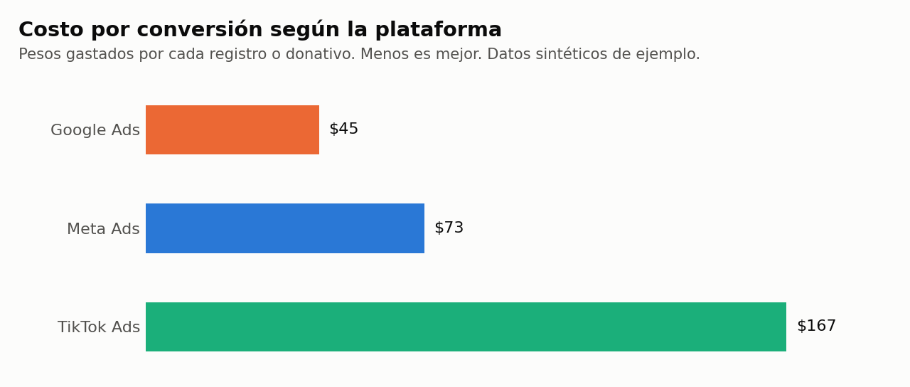
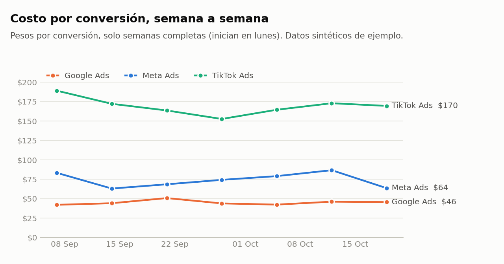

# Paid Media Kit

**Mide tus campañas de Meta, Google y TikTok Ads en una sola tabla, gratis.**
Pensado para ONGs y pequeños negocios que pagan anuncios pero no tienen un analista ni una herramienta de reportes.

> **English summary.** A small, tested Python + SQL pipeline that takes the raw CSV exports of Meta Ads, Google Ads and TikTok Ads, cleans them (dates, currency symbols, total rows, duplicates, inconsistent campaign names), stacks them into one unified table and produces KPI reports (CTR, CPC, CPM, CPA) ready for Looker Studio or Power BI. The sample data is synthetic and clearly labelled as such.

## El problema

Cada plataforma exporta sus datos a su manera: nombres de columnas distintos, fechas en formatos distintos, importes con símbolos de moneda, filas de totales mezcladas con los datos. Comparar plataformas a mano en Excel es lento y es fácil equivocarse, por ejemplo sumando dos veces una fila de total.

## Qué hace

```
exportaciones crudas  →  limpieza  →  tabla unificada  →  reportes SQL  →  gráficas
 (3 CSV distintos)                    (1 CSV limpio)      (3 CSV)          (2 PNG)
```

| Problema en el archivo crudo | Cómo se resuelve |
|---|---|
| `Sep 7, 2026`, `07/09/2026` y `2026-09-07` en el mismo análisis | Cada plataforma declara su formato de fecha |
| `MX$1,234.50`, `--`, celdas vacías | Se convierten a número; lo vacío cuenta como 0 |
| Filas de "Total" y renglones en blanco | Se descartan porque no tienen una fecha válida |
| Exportación pegada dos veces | Una sola fila por día y campaña |
| `Voluntarios Sept-Oct`, `Voluntarios_Sept_Oct`, ` voluntarios sept-oct ` | Una clave común: `voluntarios_sept_oct` |

## Resultado con los datos de ejemplo

Los datos de ejemplo son **sintéticos**: simulan a un banco de alimentos ficticio durante septiembre y octubre de 2026. Sirven para probar el kit, no describen campañas reales.

| Plataforma | Gasto (MXN) | Conversiones | CTR | CPC | CPM | **Costo por conversión** |
|---|---:|---:|---:|---:|---:|---:|
| Google Ads | 71,042 | 1,571 | 3.58% | $2.64 | $94.28 | **$45.22** |
| Meta Ads | 71,680 | 988 | 1.25% | $3.06 | $38.16 | **$72.55** |
| TikTok Ads | 70,795 | 424 | 0.84% | $2.64 | $22.09 | **$166.97** |

Lectura: con un tercio del presupuesto cada una, Google aporta el 53% de las conversiones y TikTok el 14%. TikTok tiene las impresiones más baratas, pero eso no la hace la más eficiente.





## Cómo usarlo

```bash
pip install -r requirements.txt
python -m paidmedia.pipeline
```

Con tus propios datos:

1. Exporta el reporte diario por campaña de cada plataforma en CSV.
2. Guárdalos en una carpeta con nombres que empiecen por `meta_`, `google_` o `tiktok_`.
3. Ejecuta `python -m paidmedia.pipeline --input tu_carpeta`.

El resultado queda en `output/`:

| Archivo | Contenido |
|---|---|
| `paid_media_unified.csv` | Una fila por día, plataforma y campaña |
| `01_kpis_by_platform.csv` | KPIs y participación de gasto y conversiones por plataforma |
| `02_campaign_ranking.csv` | La plataforma más barata para cada campaña |
| `03_weekly_trend.csv` | Costo por conversión semanal y su cambio contra la semana anterior |

### Llevarlo a Looker Studio o Power BI

Carga `paid_media_unified.csv` como fuente de datos (en Looker Studio con el conector de carga de archivos o desde Google Sheets; en Power BI con "Obtener datos → Texto/CSV"). Define los indicadores como **campos calculados sobre sumas**, por ejemplo `SUM(spend_mxn) / SUM(conversions)`, nunca como promedio de una columna ya dividida.

## Decisiones de análisis

- **Los KPIs se calculan sobre totales.** Promediar el CPA de cada día da un número equivocado, porque un día con una conversión pesa igual que uno con cien. Hay una prueba que lo demuestra.
- **Solo semanas completas.** La tendencia semanal descarta las semanas con menos de 7 días para no comparar una semana corta con una completa.
- **Conciliación.** Una prueba verifica que el gasto, después de limpiar, coincide con el total que reporta la propia plataforma.
- **Alertas de calidad.** El kit avisa si hay más clics que impresiones, valores negativos o conversiones sin gasto.

## Limitaciones

- Cada plataforma cuenta las conversiones con sus propias reglas de atribución. El costo por conversión entre plataformas es una guía, no una comparación exacta.
- Los nombres de columna corresponden a exportaciones en inglés. Si tu cuenta exporta en otro idioma, ajusta el diccionario `PLATFORMS` en [`paidmedia/normalize.py`](paidmedia/normalize.py).
- Todo se asume en pesos mexicanos; no convierte monedas.

## Estructura

```
paidmedia/normalize.py    limpieza y esquema unificado
paidmedia/kpis.py         indicadores calculados sobre totales
paidmedia/pipeline.py     ejecuta todo de principio a fin
paidmedia/sample_data.py  genera los datos sintéticos de ejemplo
paidmedia/charts.py       gráficas
sql/                      reportes en SQL (CTE y funciones de ventana)
tests/                    20 pruebas automáticas
```

```bash
python -m pytest
```

## Licencia

Código bajo licencia MIT. Los datos de ejemplo son sintéticos y de uso libre.
